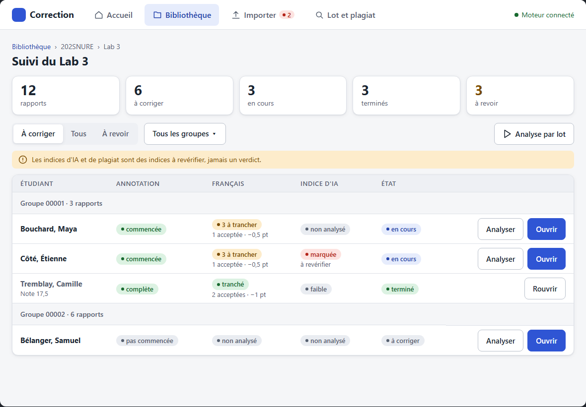
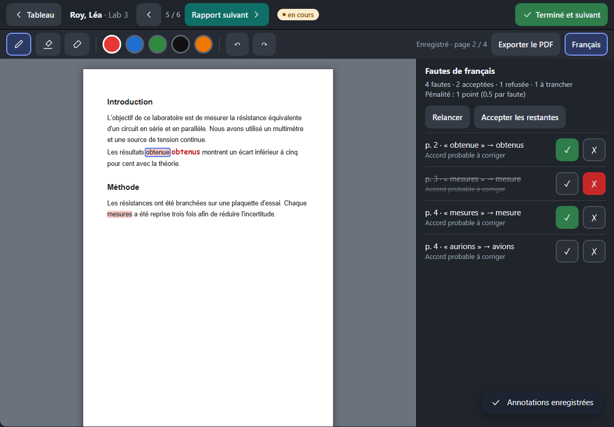

# Design de l'interface

Objectif : une app plus belle et plus sobre, **sans changer le comportement ni les API**, sans compilation (CSS et JS simples). Maquette à ouvrir dans un navigateur : [`maquette-design.html`](maquette-design.html) (3 écrans, avant / après, 2 directions, format iPad).

État : **proposition**, en attente des choix de Guillaume (section « Décisions à prendre »).

## 1. Constats sur l'app actuelle

Captures « avant » (bibliothèque fictive) : `docs/design/avant/<écran>-<ipad-paysage|ipad-portrait|pc>.png`. Exemples : [bibliothèque](design/avant/biblio-ipad-paysage.png), [suivi](design/avant/suivi-ipad-paysage.png), [lecteur + fautes](design/avant/lecteur-fautes-ipad-paysage.png), [import](design/avant/import-ipad-paysage.png).

1. **Le rouge a trois sens à la fois** : couleur de marque (onglet actif, bouton « Ouvrir »), couleur d'erreur, couleur des fautes de français. Un bouton principal rouge ressemble à un danger.
2. **Pas de système** : couleurs, rayons et espacements écrits en dur dans 4 feuilles de style (`style.css`, `suivi.css`, `lecteur.css`, `plagiat.css`). Les gris et les beiges changent d'un écran à l'autre (`#eee`, `#f1f1ee`, `#fafafa`…).
3. **Hiérarchie faible** : tous les titres sont presque pareils, le fond est blanc partout, les cartes ne se détachent pas ; l'accueil et la bibliothèque laissent les deux tiers de l'écran vides, sans état vide soigné.
4. **Tableau de suivi** : « pas commencée » se coupe sur deux lignes, l'état « en cours » aussi, les pastilles n'ont pas de couleurs d'état cohérentes, quatre boutons de poids égal par ligne (seul « Ouvrir » ressort).
5. **Formulaires natifs** (import, lot, plagiat) : champs et boutons du navigateur, non alignés avec le reste, sans zone de dépôt ni retour de progression clair.
6. **Lecteur** : réussi (sombre, le PDF ressort, cibles de 44 px), mais le panneau des fautes mélange boutons natifs (« Relancer l'analyse ») et boutons maison, et les icônes sont mélangées (SVG, symboles ✓ ✗ ‹, emojis 📊 🔍 ⚙ sur l'accueil).
7. **Retours** : aucun message de succès uniforme (« enregistré », « importé »), erreurs en simple texte rouge.

À garder : cibles de 44 px, rouge des fautes, couleurs des outils d'annotation, lisibilité du PDF, lecteur sombre.

## 2. Sources consultées et principes retenus

| Source | Ce qu'on en retient |
|---|---|
| [Apple HIG — Layout](https://developer.apple.com/design/human-interface-guidelines/layout) et [Typography](https://developer.apple.com/design/human-interface-guidelines/typography) | Cibles d'au moins 44 × 44 pt, marges et zones de sécurité, police système, un seul élément principal par zone. |
| [Refactoring UI](https://www.refactoringui.com/) (Wathan & Schoger) | Hiérarchie par la taille, la graisse et la couleur (pas seulement la taille) ; échelle d'espacement fixe ; peu de couleurs, une d'accent ; ombres légères ; un bouton principal, les autres secondaires. |
| [Material Design 3](https://m3.material.io/) | Rôles de couleur (principale, surface, erreur) plutôt que des teintes en dur ; états (survol, pression, désactivé) ; échelle typographique. |
| [Radix Colors](https://www.radix-ui.com/colors/docs/palette-composition/understanding-the-scale) | Échelle de 12 étapes : fonds (1-2), composants (3-5), bordures (6-8), plein (9), texte (11-12). Sert à choisir des fonds d'état pâles avec un texte foncé lisible. |
| [Primer (GitHub)](https://primer.style/product/getting-started/) | Jetons (variables), composants Button / Banner / Blankslate (état vide) : un état vide dit quoi faire ensuite. |
| [Fluent 2 (Microsoft)](https://fluent2.microsoft.design/) et [Atlassian Design System](https://atlassian.design/foundations/) | Espacements en multiples de 4, rayons peu nombreux, statuts (« lozenge ») en pastilles colorées avec texte, notifications éphémères pour les succès. |
| [WCAG 2.2, contraste minimum](https://www.w3.org/WAI/WCAG22/Understanding/contrast-minimum.html) | Texte normal ≥ 4,5:1, grand texte et composants ≥ 3:1. Ne jamais coder un état par la couleur seule (toujours un mot). |
| [10 heuristiques de Nielsen Norman](https://www.nngroup.com/articles/ten-usability-heuristics/) | Visibilité de l'état du système (chargement, enregistré), prévention des erreurs, messages d'erreur clairs avec une solution, design minimaliste. |
| [Laws of UX](https://lawsofux.com/) | Fitts (grandes cibles pour les actions fréquentes), Hick (peu de choix visibles), Jakob (conventions connues), Doherty (réponse sous 400 ms : afficher un état « en cours »). |
| Outils pros sobres (consultés pour l'esprit, rien de copié) : [Gradescope](https://www.gradescope.com/), [Linear](https://linear.app/), [GitHub](https://github.com/) | Tableau dense mais aéré avec statuts en pastilles ; barre d'outils compacte ; accent unique ; fond gris très clair avec cartes blanches. |

Principes retenus :

1. **Une couleur d'accent**, jamais rouge ; le rouge ne dit que « faute / erreur / danger ».
2. **Fond gris clair, cartes blanches, bordure fine + ombre légère** : la hiérarchie vient du contraste fond/carte.
3. **Échelle typographique courte** (12 à 28 px), titres en 600-700, police système (hors ligne, aucune police à télécharger).
4. **Espacements en multiples de 4**, rayons 8 et 12 px.
5. **Badges d'état = pastille + mot** (jamais la couleur seule), contraste ≥ 4,5:1.
6. **Un bouton principal par zone**, les autres en contour ou discrets.
7. **Retours systématiques** : notification brève (succès), barre de progression, message d'erreur avec quoi faire, états vides avec une action.
8. **Icônes SVG filaires d'un seul style** (traits de 1,8 px, `currentColor`), plus d'emojis.
9. **Tactile d'abord** : 44 px minimum, 8 px entre cibles voisines.

## 3. Système de design minimal

Un seul fichier `pwa/design.css` (jetons + composants), chargé avant les feuilles existantes ; elles s'y raccordent écran par écran. Les valeurs ci-dessous sont celles de la maquette (direction « sobre ») ; la direction « chaleureuse » ne change que les lignes marquées ◆.

### Jetons

```css
:root {
  --font: -apple-system, BlinkMacSystemFont, "Segoe UI", system-ui, Roboto, sans-serif;
  /* surfaces et texte */
  --bg: #f5f6f8;      --surface: #fff;    --surface-2: #eef0f4;     /* ◆ chaleureuse : #f8f5f0 / #fffefb / #f0ebe2 */
  --border: #dde1e7;  --border-fort: #b9c0cb;
  --texte: #1b2430;   --texte-2: #566070;                            /* 15,6:1 et 6,6:1 sur blanc */
  /* accent (une seule couleur) */
  --accent: #2f55d4;  --accent-fort: #2443ad;  --accent-doux: #e6ecfc;  /* ◆ chaleureuse : #0f6f66 / #0a554e / #dcf0ec */
  /* états (texte sur fond pâle, ≥ 4,5:1) */
  --ok: #17692e;        --ok-fond: #dcf2e2;
  --attention: #7a4b00; --attention-fond: #fdeccb;
  --danger: #b42318;    --danger-fond: #fde3e0;
  --info: var(--accent-fort); --info-fond: var(--accent-doux);
  --faute: rgba(229, 57, 53, .26);   /* inchangé : zones de fautes dans le PDF */
  /* espacements, rayons, ombre, cible */
  --e1: 4px; --e2: 8px; --e3: 12px; --e4: 16px; --e5: 24px; --e6: 32px;
  --r-s: 8px; --r-m: 12px; --r-pilule: 999px;                        /* ◆ chaleureuse : 10 / 16 */
  --ombre: 0 1px 2px rgba(20,30,50,.08), 0 2px 8px rgba(20,30,50,.06);
  --cible: 44px;
}
```

Typographie (échelle) : 12 légende · 13 badge, en-tête de tableau · 14 secondaire · **16 texte** · 20 titre de section · 24 titre d'écran · 28 gros chiffres. Chiffres en `font-variant-numeric: tabular-nums`.

États : survol = fond `--surface-2` ; pression = `--accent-doux` ; focus = anneau 2 px `--accent` ; désactivé = opacité .45 (pas de survol).

### Composants de base

| Composant | Règle |
|---|---|
| Bouton | `.btn` (contour), `.btn.principal` (accent plein, un seul par zone), `.btn.discret` (sans bordure), `.btn.danger` ; hauteur 44 px ; icône SVG facultative à gauche. |
| Champ | Étiquette au-dessus (14 px, 600), saisie 44 px, aide en 13 px dessous, erreur en `--danger` avec une phrase qui dit quoi faire. |
| Carte | Fond `--surface`, bordure `--border`, rayon 12, `--ombre`, marge intérieure 16-24. |
| Tableau | En-tête 13 px majuscules `--texte-2` sur `--surface-2`, lignes de 60 px, séparateur fin, ligne de groupe grisée ; en portrait, une carte par ligne. |
| Barre d'outils | Hauteur 60 px (navigation) ; contrôle segmenté pour les filtres exclusifs ; séparateurs verticaux fins. |
| Panneau | Latéral (paysage) ou bas (portrait), jamais par-dessus le PDF ; titre 16 px 600, résumé 14 px. |
| Badge d'état | Pastille + mot : ok (terminé, tranché), attention (à trancher), danger (indice marqué, plagiat confirmé), info (en cours), neutre (non analysé, à corriger). |
| Notification | Bande sombre en bas à droite, 3 s, avec icône ; erreurs : bandeau persistant en haut du contenu. |
| Bandeau (note) | `--attention-fond`, icône, une phrase (ex. « indices à revérifier, jamais un verdict »). |
| État vide | Icône, une phrase, un bouton d'action (« Importer des rapports »). |
| Progression | Barre de 8 px arrondie, `--accent`, avec le compte (« 9 / 12 »). |

Lecteur : reste sombre (variables propres `--l-*` : fond `#20242b`, barres `#262b33`, boutons `#353b45`, sélection `#7d9bff`), mêmes rayons, mêmes cibles, mêmes icônes SVG.

Mode sombre global : non proposé par défaut (voir questions) ; les jetons le permettraient plus tard en redéfinissant les variables dans `@media (prefers-color-scheme: dark)`.

## 4. Maquette

Ouvrir [`maquette-design.html`](maquette-design.html) : boutons en haut pour changer d'écran (suivi, lecteur + fautes, import) et de version (avant, sobre, chaleureuse). Captures de la maquette : `docs/design/maquette/<écran>-<sobre|chaleureuse>.png`.




## 5. Décisions à prendre (une à une)

1. **Direction** : sobre et neutre (recommandée) ou chaleureuse et éducative.
2. **Couleur d'accent** : bleu indigo `#2f55d4` (recommandé avec « sobre »), sarcelle `#0f6f66` (avec « chaleureuse »), ou autre.
3. **Mode sombre** : non pour l'instant (recommandé : le lecteur est déjà sombre, le reste suit le fond clair) ou suivre le réglage de l'iPad.
4. **Densité** : confortable (lignes de 60 px, recommandé pour le tactile) ou compacte (48 px, plus de rapports à l'écran).

## 6. Plan d'application (après accord)

- **PR 1** : `pwa/design.css` (jetons + composants) et barre de navigation, accueil, bibliothèque, import.
- **PR 2** : tableau de suivi, plagiat, lot.
- **PR 3** : lecteur et panneau des fautes (variables, icônes, boutons ; aucun changement de comportement).
- Chaque PR : captures avant/après, `pytest` si le moteur est touché (il ne devrait pas l'être), fusion de `origin/main` avant d'annoncer.
